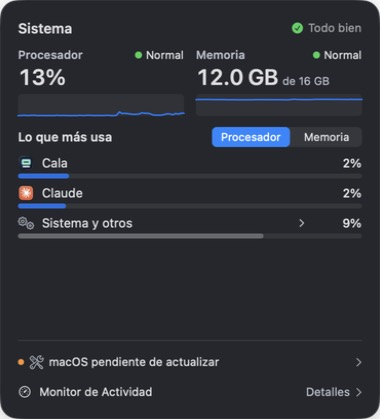
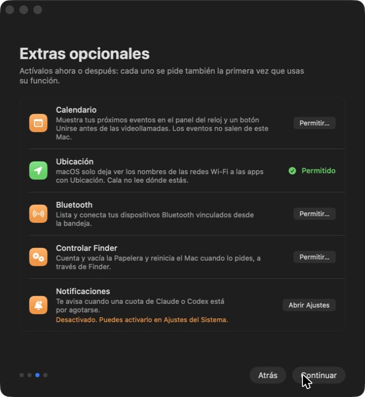

<div align="center">


# Cala

**Una barra de tareas para tu Mac.** Tus apps abajo con hasta seis vistas previas por app, y a la derecha Wi‑Fi, sonido, batería, disco, calendario y un panel que te explica por qué tu Mac va lento.

**Cala es un conjunto de módulos que activas por separado:** la barra y su bandeja, el selector de ventanas de Opción+Tab y **Zonas**, que encaja en distribuciones las ventanas que arrastras. Zonas y el selector pueden funcionar sin la barra. La bandeja necesita la barra.

Gratis · Código visible · No requiere una cuenta de Cala · macOS 14 o más nuevo · Apple silicon e Intel

### [⬇︎ Descargar la última versión](https://github.com/MineiToshio/cala-taskbar/releases/latest)

**Español** · [English](README.md)


</div>

---

## Qué hace

<table>
<tr>
<td width="50%" valign="top">

**Tus apps, abajo.** Un clic para cambiar de app, pasa el mouse para ver las vistas previas y clic derecho para anclar, abrir otra ventana o cerrarla.

**Opción + Tab** muestra hasta 20 ventanas, incluidas las minimizadas. Escribe para buscarlas. Fuera de la búsqueda, pulsa W para cerrar una, Q para salir de su app o M para minimizar o restaurar.

**La bandeja de la derecha** tiene Wi‑Fi, Bluetooth, sonido, brillo, batería, disco, teclado, descargas, papelera y un reloj con tus próximos eventos y un botón para unirte a la videollamada. Haz clic izquierdo en un icono de la bandeja para abrir su panel. Haz clic derecho o Control-clic en un elemento de la barra para **Mover a Más** u **Ocultar**, o en un elemento de Más (⌃) para **Mover a la barra** u **Ocultar**. Ambos menús incluyen **Configurar bandeja…**. Haz clic derecho en el botón Más o en el de unirte a la llamada para abrir el menú de la barra.

**Docker** aparece en la bandeja cuando Cala detecta una instalación local. Haz clic en la ballena para gestionar contenedores, imágenes y volúmenes.

**Tu correo, en la bandeja.** Un sobre con el conteo de no leídos de tus cuentas de Gmail, iCloud o Yahoo; lee, archiva o elimina sin abrir el navegador. Mira [Correo](#correo).

**¿Por qué mi Mac va lento?** El panel de CPU y memoria te dice qué app pesa más y te recomienda reiniciar cuando hace falta.

**Zonas.** Arrastra una ventana, haz clic derecho o mantén Mayús, y suéltala en una zona: mitades, tercios, una cuadrícula o una distribución que dibujes, con una distinta en cada pantalla. Funciona con o sin la barra. Mira [Zonas](#zonas).

</td>
<td width="50%" valign="top">

</td>
</tr>
</table>

---

## Instalar

### Opción 1: con un comando (recomendada, sin avisos de macOS)

Abre **Terminal** (búscala con Spotlight: ⌘ + Espacio, "Terminal"), pega esta línea y pulsa Enter:

```bash
curl -fsSL https://raw.githubusercontent.com/MineiToshio/cala-taskbar/main/scripts/get-cala.sh | bash
```

Descarga la última versión, comprueba que el archivo es el publicado aquí (SHA-256), instala Cala en `/Applications` si tienes permiso de escritura (si no, en `~/Applications`) y la abre. Como no pasa por el navegador, macOS no la bloquea. Sirve también para **actualizar**, y tus ajustes se conservan. Puedes [leer el script](scripts/get-cala.sh) antes de usarlo. Luego sigue la bienvenida de Cala.

### Opción 2: descargando el archivo

1. **Descarga** `Cala-x.y.z.dmg` desde [Releases](https://github.com/MineiToshio/cala-taskbar/releases/latest).
2. **Ábrelo** y arrastra **Cala** a la carpeta **Aplicaciones**.
3. **Ábrela la primera vez.** Cala es gratis y no está firmada por Apple (eso cuesta 99 USD al año), así que macOS la bloquea **una sola vez**:

   **macOS 15 (Sequoia) o más nuevo**
   1. Haz doble clic en **Cala** dentro de Aplicaciones. Aparece *"Apple no pudo verificar…"*: pulsa **Listo**.
   2. Abre **Ajustes del Sistema → Privacidad y seguridad** y baja hasta el final.
   3. Junto a *"Se bloqueó el uso de Cala"*, pulsa **Abrir igualmente** y escribe tu contraseña.
   4. Vuelve a abrir Cala y elige **Abrir igualmente**.

   **macOS 14 (Sonoma)**: en Aplicaciones, haz clic derecho sobre **Cala → Abrir**, y otra vez **Abrir**.

   Después de esto, Cala abre normal para siempre. (Con el comando de arriba te saltas este paso.)

4. **Sigue la bienvenida.** Son pocos pasos. Primero pregunta **qué quieres usar** (la barra, Zonas o las dos) y luego pide solo los permisos que esa elección necesita.

<details>
<summary>¿Prefieres la Terminal? Un comando hace lo mismo que el paso 3</summary>

```bash
xattr -dr com.apple.quarantine /Applications/Cala.app
```
</details>

> **¿Es seguro?** El código está completo en este repositorio: puedes leerlo y compilarlo tú mismo (ver [Compilar desde el código](#compilar-desde-el-código)). El aviso de macOS solo significa que la app no pasó por el pago de Apple, no que tenga algo malo.

---

## Correo

Haz clic en el sobre de la bandeja para ver los últimos correos de tu bandeja de entrada, con filtros por cuenta si tienes dos o más. Abre uno para leerlo dentro de Cala con su formato real, y luego **Archivar**, **Eliminar** o **Abrir en Gmail / Mail de iCloud / Yahoo Mail**. Al abrir un correo en Cala se marca como leído en el servidor, y el correo nuevo llega en tiempo real.

**Proveedores:** Gmail (también Google Workspace, si el administrador de tu empresa permite IMAP y contraseñas de aplicación), iCloud y Yahoo. Outlook y Hotmail no se admiten: Microsoft exige iniciar sesión con OAuth.

**Conectar una cuenta:** *Configuración → Integraciones → Correo* te guía paso a paso, con botones a las páginas correctas de tu proveedor. Cala inicia sesión con una **contraseña de aplicación**: un código que tu proveedor genera solo para Cala. **No** es tu contraseña normal del correo. En Gmail necesitas tener activada la verificación en dos pasos para crearla.

**Imágenes:** las imágenes remotas de los correos se cargan por defecto. Desactívalo en *Configuración → Integraciones → Correo* si prefieres bloquearlas: cuando se cargan, el remitente puede saber que abriste el correo. En los correos no se ejecuta JavaScript y los enlaces se abren en tu navegador.

---

## Zonas

Zonas te deja acomodar ventanas sin cambiarles el tamaño a mano. Activa Zonas en la bienvenida o en *Configuración → Zonas*.

1. **Arrastra una ventana** por su barra de título.
2. **Sin soltar el botón, haz clic derecho** (o **mantén Mayús**). Aparecen tus zonas en esa pantalla.
3. **Ponte sobre una zona y suelta.** La ventana toma su posición y su tamaño.

Para usar otra distribución, pasa sobre la píldora **Cambiar distribución** arriba de la pantalla mientras se ven las zonas y detente en la que quieras. Mantén **⌘** para cubrir varias zonas vecinas a la vez. Vuelve a hacer clic derecho, suelta Mayús o suelta fuera de todas las zonas para cancelar: la ventana se queda donde la soltaste. Si arrastras una ventana encajada para sacarla, recupera su tamaño anterior.

- **Distribuciones:** ocho plantillas y tantas distribuciones propias como quieras. Abre *Configuración → Zonas → Editar zonas…* o usa el icono de Cala en la barra de menús. En **Mosaico**, divide y une zonas o arrastra los bordes compartidos. En **Libre**, dibuja, mueve y redimensiona zonas con guías de ajuste y una cuadrícula opcional de 12 divisiones. Elige una distribución o desactiva las zonas en cada pantalla.
- **Sin la barra:** apaga la barra en *Configuración → General* y Cala vive en la barra de menús, sin barra de tareas y sin reservar espacio. El Dock y la barra de menús quedan como macOS los tiene.
- **Con la barra:** las zonas nunca quedan debajo de la barra cuando está siempre visible.
- **Permiso:** solo **Accesibilidad**. Zonas nunca graba la pantalla ni lee el teclado.
- **macOS 15 o más nuevo** también puede acomodar una ventana que sueltas junto a un borde de la pantalla. Si estorba, desactiva *Arrastrar ventanas a los bordes de la pantalla para acomodarlas* en *Ajustes del Sistema → Escritorio y Dock → Ventanas* (*Configuración → Zonas* tiene un botón).
- En un trackpad no puedes hacer clic derecho mientras mantienes el arrastre. Mantén **Mayús** al arrastrar. En *Configuración → Zonas → Activar zonas con*, elige **Mantener Mayús** o deja **Cualquiera de los dos** (la opción predeterminada).

Más en [docs/zones.md](docs/zones.md) (en inglés).

---

## Permisos



Cala pide cada permiso con una frase que explica para qué sirve y un botón que abre el panel justo de **Ajustes del Sistema**. Cala detecta en vivo los cambios de Accesibilidad. Para Grabación de pantalla, sigue el aviso de macOS si te pide salir y volver a abrir.

| Permiso | Para qué | Si no lo das |
|---|---|---|
| **Accesibilidad** | Ver, enfocar, minimizar y cerrar ventanas; Opción+Tab; mover ventanas a zonas | La barra igual abre tus apps, sin manejar ventanas; Zonas no puede mover ventanas |
| **Grabación de pantalla** | Miniaturas de las ventanas | No hay miniaturas. Cala nunca graba ni envía tu pantalla |
| Calendario | Próximos eventos y botón Unirse | El reloj no muestra eventos |
| Ubicación | macOS solo deja ver nombres de redes Wi‑Fi con este permiso | No se ven nombres de redes |
| Bluetooth | Ver y conectar tus dispositivos | No se listan |
| Controlar Finder | Contar y vaciar la Papelera, reiniciar | Esas acciones no están |
| Notificaciones | Avisos de cuota de Claude o Codex | Sin avisos |

Para **Accesibilidad** y **Grabación de pantalla**, macOS abre una lista: activa **Cala** (te pedirá Touch ID o contraseña). Si tras Grabación de pantalla macOS ofrece **Salir y volver a abrir**, acéptalo.

Solo se piden los permisos de los módulos que usas: **Zonas sola necesita únicamente Accesibilidad**. ¿Dijiste que no a algo? Todo lo demás sigue funcionando. Actívalo cuando quieras en **Configuración → Permisos** (clic derecho en una zona vacía de la barra → Configuración…, o el icono de Cala en la barra de menús).

<br clear="right">

### El aviso del Llavero (Correo)

Una vez, tras la actualización que trae el ayudante de Llavero de Cala, macOS puede mostrar **hasta dos ventanas** por cada cuenta de correo guardada con una versión anterior: *«cala-keychain quiere acceder a la llave "Cala Mail" de tu llavero.»* (botones *Permitir siempre*, *Denegar* y *Permitir*) y otra que pide *«Para permitir esto, introduce la contraseña del llavero Inicio de sesión»*, que es la **contraseña de tu Mac**. **Haz clic** en **Permitir siempre** en ambas: pulsar Intro tras escribir la contraseña elige *Permitir*, que solo vale esta vez. Esa contraseña va solo a macOS: Cala nunca la ve. Cala es gratis y no está firmada con un Apple Developer ID de pago, así que macOS confía en un programa por su huella exacta. Solo el pequeño ayudante `cala-keychain` dentro de Cala.app toca el Llavero, y no cambia entre actualizaciones. Tras leer una entrada antigua copia la contraseña a su propia entrada (mismo servicio "Cala Mail", cuenta `v2:<tu correo>`), en la que macOS confía sin preguntar, así que los siguientes arranques y actualizaciones no vuelven a preguntar. Las cuentas que añadas después van directas a la entrada del ayudante. Solo una actualización que tenga que reemplazar el ayudante (algo raro) pregunta una vez más.

La entrada antigua (cuenta = tu correo, sin `v2:`) se queda, porque macOS no deja que el ayudante la borre. Puedes borrarla tú en **Acceso a Llaveros** (busca "Cala Mail") cuando ya exista la entrada `v2:`, y también después de quitar una cuenta en Cala. Si las ventanas vuelven en cada arranque, abre esa entrada antigua en Acceso a Llaveros → **Control de acceso** → **+** y añade `/Applications/Cala.app/Contents/Helpers/cala-keychain` (⌘⇧G para escribir la ruta), y luego **Guardar cambios**.

---

## Uso diario

- **Configuración**: clic derecho en una zona vacía de la barra → *Configuración…*, o clic en el icono de Cala de la barra de menús (aparece si la barra está apagada o Zonas está activa), o vuelve a abrir Cala desde Aplicaciones.
- **Módulos**: *Configuración → General → Qué hace Cala* muestra los interruptores, estados y accesos a Zonas, Barra de tareas, Selector de ventanas y Bandeja. Las páginas siguen disponibles con los módulos apagados y ofrecen la acción **Activar**. Abre **Integraciones** para configurar Correo, Calendario y Claude y Codex.
- **Bandeja:** pulsa y arrastra un icono de la bandeja en la barra para reordenarlo. En Configuración, arrastra desde el asa dentro de un grupo o entre **En la barra**, **En Más** y **Ocultos**. Puedes soltar al inicio de un grupo o en uno vacío. Las filas de CPU y memoria, Disco, Correo y Claude y Codex abren un detalle con botón para volver al pulsar el chevrón o cualquier parte de la fila fuera del asa.
- **Abrir al iniciar sesión**: se elige en la bienvenida o en *Configuración → General*. Aparece en *Ajustes del Sistema → General → Ítems de inicio*.
- **Idioma**: español o inglés; por defecto, el de tu Mac. Se cambia en *Configuración → General → Idioma*.
- **Barra de tareas**: en *Configuración → Barra de tareas* se ajustan la ocultación del Dock y de la barra de menús, el tamaño de los iconos, la transparencia, las vistas previas y la alineación por pantalla. El tema compartido está en *General → Tema de Cala*.
- **Selector de ventanas**: *Configuración → Selector de ventanas* indica si Opción + Tab está disponible, incluso cuando faltan las miniaturas. También incluye la opción Comando + Tab y cómo buscar.
- **Actualizar**: vuelve a ejecutar el comando de la opción 1, o descarga el nuevo DMG y reemplaza Cala en Aplicaciones. Cada cuenta conserva sus propios ajustes. Las cuentas que usan `/Applications/Cala.app` comparten la copia instalada. Otras sesiones que ya ejecutan esa copia se reinician con la nueva compilación cuando están activas y no hay bloqueos, como una ventana de Configuración abierta o un arrastre en curso.

## Desinstalar

*Configuración → Ayuda y diagnóstico → Opciones avanzadas → **Desinstalar Cala → Desinstalar…*** devuelve el Dock y la barra de menús a como estaban, quita el inicio de sesión, borra los ajustes de Cala y intenta mover la app a la Papelera. Quitar la copia compartida afecta a todas las cuentas.

Los permisos quedan listados en *Ajustes del Sistema → Privacidad y seguridad*; puedes quitarlos allí. Sin abrir la app: [`scripts/uninstall.sh`](scripts/uninstall.sh).

## Privacidad

Las funciones de ventanas y distribuciones de Cala funcionan localmente. Las integraciones conectadas usan tus cuentas existentes. Claude y Codex pueden consultar el uso con sus proveedores, y Correo se conecta al servidor IMAP del proveedor y puede cargar imágenes remotas. *Reportar un problema* muestra el mensaje, el correo de contacto opcional y los adjuntos de texto. Cala quita tu carpeta personal, tu nombre de usuario, el nombre del Mac y las direcciones de correo del texto técnico. Al enviar desde Cala, el informe también incluye contexto estructurado, como la versión de macOS, el modelo del Mac y el estado de los permisos. Si la versión que descargaste no tiene envío configurado, puedes **copiar el informe** y pegarlo en un [issue](https://github.com/MineiToshio/cala-taskbar/issues).

**Correo:** las contraseñas de aplicación se guardan en el Llavero de macOS (servicio "Cala Mail") y el contenido de tus correos se queda en tu Mac. Puedes revocar el acceso cuando quieras borrando la contraseña de aplicación en tu cuenta de Google, Apple o Yahoo.

## Problemas frecuentes

- **"Cala no se puede abrir" / "Apple no pudo verificar…"**: es el bloqueo de una sola vez; mira el paso 3 de [Instalar](#instalar), o instala con el comando de Terminal, que no lo muestra.
- **No veo miniaturas**: activa Grabación de pantalla en *Configuración → Permisos*.
- **Zonas no hace nada**: necesita Accesibilidad (*Configuración → Permisos*); arranca sola cuando la permites. Comprueba que Zonas esté activa en *Configuración → General → Qué hace Cala*.
- **El Dock desapareció**: Cala lo oculta solo si lo pediste. Desactiva **Ocultar el Dock de macOS** en *Configuración → Barra de tareas*.
- **macOS dice «cala-keychain quiere acceder a la llave "Cala Mail" de tu llavero.»**: es lo esperado una vez, hasta dos ventanas por cuenta; mira [El aviso del Llavero](#el-aviso-del-llavero-correo). Haz clic en **Permitir siempre** en ambas (escribe la contraseña de tu Mac si te la pide; Intro elige *Permitir*, que solo vale una vez); va a macOS, no a Cala. Si pregunta en cada arranque, usa el arreglo manual de esa sección.
- **Correo dice «Reinicia Cala para actualizar el acceso al llavero.»**: Cala se actualizó o se reemplazó mientras seguía abierta. Sal de Cala y vuelve a abrirla. **«macOS no pudo confirmar que la petición al Llavero venía de Cala»** (solo builds con Developer ID): reinicia tu Mac; si se repite, reinstala Cala.
- **Algo falla**: abre *Configuración → Ayuda y diagnóstico → Reportar un problema → Reportar…*, usa **Reportar un problema…** en el menú de clic derecho de la barra o crea un [issue](https://github.com/MineiToshio/cala-taskbar/issues).

## Compilar desde el código

Necesitas las herramientas de línea de comandos de Xcode (`xcode-select --install`).

```bash
git clone https://github.com/MineiToshio/cala-taskbar.git && cd cala-taskbar
./install.sh            # compila, instala en /Applications para todas las cuentas y abre Cala
```

`./build.sh` y `./scripts/make-dmg.sh` generan el `.app` universal y el DMG. Más en [docs/](docs/README.md) y, para publicar versiones, [docs/release.md](docs/release.md).

---

Licencia: [PolyForm Noncommercial 1.0.0](LICENSE). Cala es gratis para descargar, usar y modificar con fines personales u otros fines no comerciales. Venderla o usar su código con fines comerciales requiere permiso del autor.
