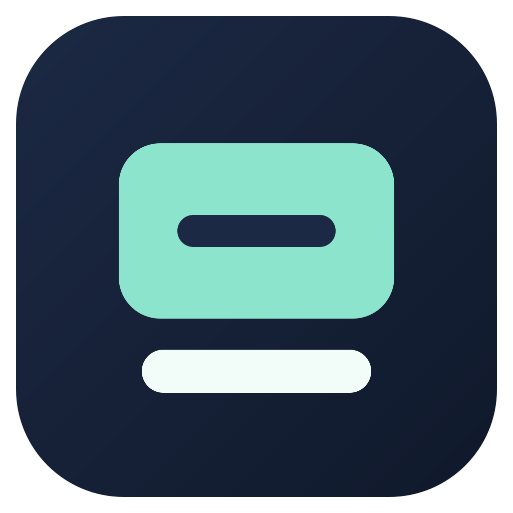
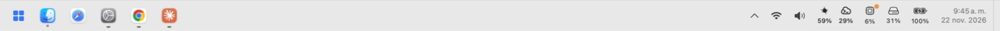

<div align="center">



# Cala

**Una barra de tareas para tu Mac.** Tus apps abajo con miniaturas de cada ventana, y a la derecha Wi‑Fi, sonido, batería, disco, calendario y un panel que te explica por qué tu Mac va lento.

**Cala es un conjunto de módulos que activas por separado:** la barra (con su bandeja y Opción+Tab) y **Zonas**, que encaja en distribuciones las ventanas que arrastras. ¿Solo quieres Zonas? Apaga la barra.

Gratis · Código visible · Sin cuentas · Nada sale de tu Mac · macOS 14 o más nuevo · Apple silicon e Intel

### [⬇︎ Descargar la última versión](https://github.com/MineiToshio/cala-taskbar/releases/latest)

**Español** · [English](README.md)



</div>

---

## Qué hace

<table>
<tr>
<td width="50%" valign="top">

**Tus apps, abajo.** Un clic para cambiar de app, pasa el mouse para ver cada ventana y clic derecho para anclar, abrir otra ventana o cerrarla.

**Opción + Tab** te muestra todas tus ventanas, no solo las apps. Escribe para buscarlas, W para cerrar una, Q para salir de su app, M para minimizar o restaurar.

**La bandeja de la derecha** tiene Wi‑Fi, Bluetooth, sonido, brillo, batería, disco, teclado, descargas, papelera y un reloj con tus próximos eventos y un botón para unirte a la videollamada.

**Tu correo, en la bandeja.** Un sobre con el conteo de no leídos de tus cuentas de Gmail, iCloud o Yahoo; lee, archiva o elimina sin abrir el navegador. Mira [Correo](#correo).

**¿Por qué mi Mac va lento?** El panel de CPU y memoria te dice qué app pesa más y te recomienda reiniciar cuando hace falta.

**Zonas.** Arrastra una ventana, haz clic derecho o mantén Mayús, y suéltala en una zona: mitades, tercios, una cuadrícula o una distribución que dibujes, con una distinta en cada pantalla. Funciona con o sin la barra. Mira [Zonas](#zonas).

</td>
<td width="50%" valign="top">

</td>
</tr>
</table>

---

## Instalar

### Opción 1: con un comando (recomendada, sin avisos de macOS)

Abre **Terminal** (búscala con Spotlight: ⌘ + Espacio, "Terminal"), pega esta línea y pulsa Enter:

```bash
curl -fsSL https://raw.githubusercontent.com/MineiToshio/cala-taskbar/main/scripts/get-cala.sh | bash
```

Descarga la última versión, comprueba que el archivo es el publicado aquí (SHA-256), instala Cala en Aplicaciones y la abre. Como no pasa por el navegador, macOS no la bloquea. Sirve también para **actualizar**, y tus ajustes se conservan. Puedes [leer el script](scripts/get-cala.sh) antes de usarlo. Luego sigue la bienvenida de Cala.

### Opción 2: descargando el archivo

1. **Descarga** `Cala-x.y.z.dmg` desde [Releases](https://github.com/MineiToshio/cala-taskbar/releases/latest).
2. **Ábrelo** y arrastra **Cala** a la carpeta **Aplicaciones**.
3. **Ábrela la primera vez.** Cala es gratis y no está firmada por Apple (eso cuesta 99 USD al año), así que macOS la bloquea **una sola vez**:

   **macOS 15 (Sequoia) o más nuevo**
   1. Haz doble clic en **Cala** dentro de Aplicaciones. Aparece *"Apple no pudo verificar…"*: pulsa **Listo**.
   2. Abre **Ajustes del Sistema → Privacidad y seguridad** y baja hasta el final.
   3. Junto a *"Se bloqueó el uso de Cala"*, pulsa **Abrir igualmente** y escribe tu contraseña.
   4. Vuelve a abrir Cala y elige **Abrir igualmente**.

   **macOS 14 (Sonoma)**: en Aplicaciones, haz clic derecho sobre **Cala → Abrir**, y otra vez **Abrir**.

   Después de esto, Cala abre normal para siempre. (Con el comando de arriba te saltas este paso.)

4. **Sigue la bienvenida.** Son pocos pasos. Primero pregunta **qué quieres usar** (la barra, Zonas o las dos) y luego pide solo los permisos que esa elección necesita.

<details>
<summary>¿Prefieres la Terminal? Un comando hace lo mismo que el paso 3</summary>

```bash
xattr -dr com.apple.quarantine /Applications/Cala.app
```
</details>

> **¿Es seguro?** El código está completo en este repositorio: puedes leerlo y compilarlo tú mismo (ver [Compilar desde el código](#compilar-desde-el-código)). El aviso de macOS solo significa que la app no pasó por el pago de Apple, no que tenga algo malo.

---

## Correo

Haz clic en el sobre de la bandeja para ver los últimos correos de tu bandeja de entrada, con filtros por cuenta si tienes dos o más. Abre uno para leerlo dentro de Cala con su formato real, y luego **Archivar**, **Eliminar** o **Abrir en Gmail / Mail de iCloud / Yahoo Mail**. Al abrir un correo en Cala se marca como leído en el servidor, y el correo nuevo llega en tiempo real.

**Proveedores:** Gmail (también Google Workspace, si el administrador de tu empresa permite IMAP y contraseñas de aplicación), iCloud y Yahoo. Outlook y Hotmail no se admiten: Microsoft exige iniciar sesión con OAuth.

**Conectar una cuenta:** *Configuración → Correo* te guía paso a paso, con botones a las páginas correctas de tu proveedor. Cala inicia sesión con una **contraseña de aplicación**: un código que tu proveedor genera solo para Cala. **No** es tu contraseña normal del correo. En Gmail necesitas tener activada la verificación en dos pasos para crearla.

**Imágenes:** las imágenes remotas de los correos se cargan por defecto. Desactívalo en *Configuración → Correo* si prefieres bloquearlas: cuando se cargan, el remitente puede saber que abriste el correo. En los correos no se ejecuta JavaScript y los enlaces se abren en tu navegador.

---

## Zonas

Zonas te deja acomodar ventanas sin cambiarles el tamaño a mano. Actívalo en la bienvenida, o en *Configuración → General → Qué hace Cala*.

1. **Arrastra una ventana** por su barra de título.
2. **Sin soltar el botón, haz clic derecho** (o **mantén Mayús**). Aparecen tus zonas en esa pantalla.
3. **Ponte sobre una zona y suelta.** La ventana toma su posición y su tamaño.

Mantén **⌘** para cubrir varias zonas vecinas a la vez. Vuelve a hacer clic derecho, suelta Mayús o suelta fuera de todas las zonas para cancelar: la ventana se queda donde la soltaste. Si arrastras una ventana encajada para sacarla, recupera su tamaño anterior.

- **Distribuciones:** ocho ya hechas (dos y tres columnas, cuadrícula 2 × 2, principal + lateral, dos filas...) y todas las tuyas que quieras. Se dibujan en el editor (*Configuración → Zonas → Editar zonas…*, o el icono de Cala en la barra de menús): arrastra para dibujar, mueve y cambia el tamaño con guías que se pegan a las otras zonas, una cuadrícula opcional de 12 divisiones y una distribución por pantalla (o ninguna).
- **Sin la barra:** apaga la barra en *Configuración → General* y Cala vive en la barra de menús, sin barra de tareas y sin reservar espacio. El Dock y la barra de menús quedan como macOS los tiene.
- **Con la barra:** las zonas nunca quedan debajo de la barra cuando está siempre visible.
- **Permiso:** solo **Accesibilidad**. Zonas nunca graba la pantalla ni lee el teclado.
- **macOS 15 o más nuevo** también puede acomodar una ventana que sueltas junto a un borde de la pantalla. Si estorba, desactiva *Arrastrar ventanas a los bordes de la pantalla para acomodarlas* en *Ajustes del Sistema → Escritorio y Dock → Ventanas* (*Configuración → Zonas* tiene un botón).
- Si el clic derecho falla al arrastrar, elige **Mantener Mayús** en *Configuración → Zonas → Activar zonas con*.

Más en [docs/zones.md](docs/zones.md) (en inglés).

---

## Permisos


Cala pide cada permiso con una frase que explica para qué sirve y un botón que abre el panel justo de **Ajustes del Sistema**. Cuando lo activas, Cala lo nota sola, sin reiniciar.

| Permiso | Para qué | Si no lo das |
|---|---|---|
| **Accesibilidad** | Ver, enfocar, minimizar y cerrar ventanas; Opción+Tab; mover ventanas a zonas | La barra igual abre tus apps, sin manejar ventanas; Zonas no puede mover ventanas |
| **Grabación de pantalla** | Miniaturas de las ventanas | No hay miniaturas. Cala nunca graba ni envía tu pantalla |
| Calendario | Próximos eventos y botón Unirse | El reloj no muestra eventos |
| Ubicación | macOS solo deja ver nombres de redes Wi‑Fi con este permiso | No se ven nombres de redes |
| Bluetooth | Ver y conectar tus dispositivos | No se listan |
| Controlar Finder | Contar y vaciar la Papelera, reiniciar | Esas acciones no están |
| Notificaciones | Avisos de cuota de Claude o Codex | Sin avisos |

Para **Accesibilidad** y **Grabación de pantalla**, macOS abre una lista: activa **Cala** (te pedirá Touch ID o contraseña). Si tras Grabación de pantalla macOS ofrece **Salir y volver a abrir**, acéptalo.

Solo se piden los permisos de los módulos que usas: **Zonas sola necesita únicamente Accesibilidad**. ¿Dijiste que no a algo? Todo lo demás sigue funcionando. Actívalo cuando quieras en **Configuración → Permisos** (clic derecho en una zona vacía de la barra → Configuración…, o el icono de Cala en la barra de menús).

<br clear="right">

### El aviso del Llavero (Correo)

Después de cada actualización de Cala, macOS muestra *«Cala quiere acceder a la llave "Cala Mail" de tu llavero.»*, una vez por cuenta de correo, y pide *«Para permitir esto, introduce la contraseña del llavero Inicio de sesión»*, que es la **contraseña de tu Mac**. Escríbela y pulsa **Permitir siempre** (los otros botones son *Denegar* y *Permitir*). Esa contraseña va solo a macOS: Cala nunca la ve. Pasa porque Cala es gratis y no está firmada con un Apple Developer ID de pago, así que macOS revisa cada versión nueva antes de entregarle la contraseña de aplicación guardada.

---

## Uso diario

- **Configuración**: clic derecho en una zona vacía de la barra → *Configuración…*, o clic en el icono de Cala de la barra de menús (aparece si la barra está apagada o Zonas está activa), o vuelve a abrir Cala desde Aplicaciones.
- **Módulos**: *Configuración → General → Qué hace Cala* tiene un interruptor para Barra, Bandeja, Selector de ventanas y Zonas; arrancan y se detienen al instante. La Bandeja vive dentro de la Barra. Si ya usabas Cala, no cambió nada: Barra, Bandeja y selector siguen activos y Zonas apagada hasta que la actives.
- **Abrir al iniciar sesión**: se elige en la bienvenida o en *Configuración → General*. Aparece en *Ajustes del Sistema → General → Ítems de inicio*.
- **Idioma**: español o inglés; por defecto, el de tu Mac. Se cambia en *Configuración → General → Idioma*.
- **Ocultar el Dock de macOS**: *Configuración → General*. Al apagarlo, o al salir de Cala, el Dock vuelve exactamente como estaba.
- **Actualizar**: vuelve a ejecutar el comando de la opción 1, o descarga el nuevo DMG y reemplaza Cala en Aplicaciones. Tus ajustes y permisos se conservan.

## Desinstalar

*Configuración → Avanzado → **Desinstalar Cala…*** devuelve el Dock y la barra de menús a como estaban, quita el inicio de sesión, borra los ajustes de Cala y mueve la app a la Papelera.

Los permisos quedan listados en *Ajustes del Sistema → Privacidad y seguridad*; puedes quitarlos allí. Sin abrir la app: [`scripts/uninstall.sh`](scripts/uninstall.sh).

## Privacidad

Nada sale de tu Mac salvo que tú lo envíes. *Reportar un problema* te muestra exactamente qué se incluye antes de enviarlo, y quita tu carpeta personal, tu nombre de usuario, el nombre del Mac y tus correos. Si la versión que descargaste no tiene envío configurado, puedes **copiar el informe** y pegarlo en un [issue](https://github.com/MineiToshio/cala-taskbar/issues).

**Correo:** las contraseñas de aplicación se guardan en el Llavero de macOS (servicio "Cala Mail") y el contenido de tus correos se queda en tu Mac. Cala solo habla con el servidor IMAP de tu proveedor. Puedes revocar el acceso cuando quieras borrando la contraseña de aplicación en tu cuenta de Google, Apple o Yahoo.

## Problemas frecuentes

- **"Cala no se puede abrir" / "Apple no pudo verificar…"**: es el bloqueo de una sola vez; mira el paso 3 de [Instalar](#instalar), o instala con el comando de Terminal, que no lo muestra.
- **No veo miniaturas**: activa Grabación de pantalla en *Configuración → Permisos*.
- **Zonas no hace nada**: necesita Accesibilidad (*Configuración → Permisos*); arranca sola cuando la permites. Comprueba que Zonas esté activa en *Configuración → General → Qué hace Cala*.
- **El Dock desapareció**: Cala lo oculta solo si lo pediste. Apágalo en *Configuración → General*, o sal de Cala.
- **macOS dice «Cala quiere acceder a la llave "Cala Mail" de tu llavero.»**: es lo esperado tras cada actualización; mira [El aviso del Llavero](#el-aviso-del-llavero-correo). Escribe la contraseña de tu Mac (la del llavero Inicio de sesión) y pulsa **Permitir siempre**; va a macOS, no a Cala.
- **Algo falla**: clic derecho en la barra → *Reportar un problema…*, o abre un [issue](https://github.com/MineiToshio/cala-taskbar/issues).

## Compilar desde el código

Necesitas las herramientas de línea de comandos de Xcode (`xcode-select --install`).

```bash
git clone https://github.com/MineiToshio/cala-taskbar.git && cd cala-taskbar
./install.sh            # compila e instala en ~/Applications y la abre
```

`./build.sh` y `./scripts/make-dmg.sh` generan el `.app` universal y el DMG. Más en [docs/](docs/README.md) y, para publicar versiones, [docs/release.md](docs/release.md).

---

Licencia: [PolyForm Noncommercial 1.0.0](LICENSE). Cala es gratis para descargar, usar y modificar con fines personales u otros fines no comerciales. Venderla o usar su código con fines comerciales requiere permiso del autor.
