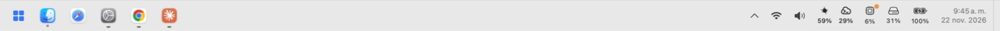
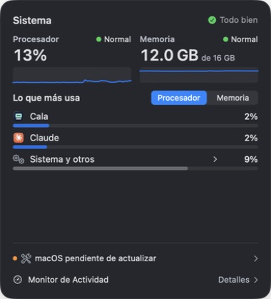
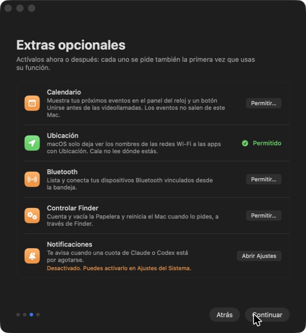

<div align="center">


# Cala

**A taskbar for your Mac.** Your apps at the bottom with a thumbnail of every window, and on the right Wi‑Fi, sound, battery, disk, calendar and a panel that tells you why your Mac is slow.

Free · Source available · No accounts · Nothing leaves your Mac · macOS 14 or later · Apple silicon and Intel

### [⬇︎ Download the latest version](https://github.com/MineiToshio/cala-taskbar/releases/latest)

**English** · [Español](README.es.md)



</div>

---

## What it does

<table>
<tr>
<td width="50%" valign="top">

**Your apps, at the bottom.** Click to switch apps, hover to see each window, right-click to pin, open a new window or quit.

**Option + Tab** shows all your windows, not just your apps.

**The tray on the right** has Wi‑Fi, Bluetooth, sound, brightness, battery, disk, keyboard, Downloads, Trash, and a clock with your upcoming events and a button to join the video call.

**Your mail, in the tray.** An envelope with the unread count of your Gmail, iCloud or Yahoo accounts; read, archive or delete without opening a browser. See [Mail](#mail).

**Why is my Mac slow?** The CPU and memory panel tells you which app weighs the most and recommends a restart when it is worth it.

</td>
<td width="50%" valign="top">

</td>
</tr>
</table>

---

## Install

### Option 1: one command (recommended, no macOS warnings)

Open **Terminal** (find it with Spotlight: ⌘ + Space, "Terminal"), paste this line and press Return:

```bash
curl -fsSL https://raw.githubusercontent.com/MineiToshio/cala-taskbar/main/scripts/get-cala.sh | bash
```

It downloads the latest version, checks that the file is the one published here (SHA-256), installs Cala in Applications and opens it. Because it does not go through the browser, macOS does not block it. It also **updates** Cala, and your settings are kept. You can [read the script](scripts/get-cala.sh) before running it. Then follow Cala's welcome window.

### Option 2: download the file

1. **Download** `Cala-x.y.z.dmg` from [Releases](https://github.com/MineiToshio/cala-taskbar/releases/latest).
2. **Open it** and drag **Cala** to the **Applications** folder.
3. **Open it the first time.** Cala is free and not signed by Apple (that costs 99 USD a year), so macOS blocks it **once**:

   **macOS 15 (Sequoia) or later**
   1. Double-click **Cala** in Applications. You see *"Apple could not verify…"*: press **Done**.
   2. Open **System Settings → Privacy & Security** and scroll to the bottom.
   3. Next to *"Cala was blocked"*, press **Open Anyway** and enter your password.
   4. Open Cala again and choose **Open Anyway**.

   **macOS 14 (Sonoma)**: in Applications, right-click **Cala → Open**, then **Open** again.

   After that, Cala opens normally for good. (Option 1 skips this step.)

4. **Follow the welcome.** Four short steps, and you can skip any of them.

<details>
<summary>Prefer Terminal? One command does the same as step 3</summary>

```bash
xattr -dr com.apple.quarantine /Applications/Cala.app
```
</details>

> **Is it safe?** All the code is in this repository: you can read it and build it yourself (see [Build from source](#build-from-source)). The macOS warning only means the app did not go through Apple's paid program, not that something is wrong with it.

---

## Mail

Click the envelope in the tray to see the latest emails in your inbox, with filter chips when you have two or more accounts. Open one to read it inside Cala with its real formatting, then **Archive**, **Delete** or **Open in Gmail / iCloud Mail / Yahoo Mail**. Opening an email in Cala marks it as read on the server, and new mail arrives in real time.

**Providers:** Gmail (also Google Workspace, if your company admin allows IMAP and app passwords), iCloud and Yahoo. Outlook and Hotmail are not supported: Microsoft requires an OAuth sign-in.

**Connect an account:** *Settings → Mail* guides you step by step, with buttons to the right pages of your provider. Cala signs in with an **app password**: a code your provider generates just for Cala. It is **not** your normal email password. Gmail needs 2-Step Verification turned on to create one.

**Images:** remote images in emails load by default. Turn that off in *Settings → Mail* if you prefer to block them: when images load, the sender can tell you opened the email. No JavaScript runs in emails, and links open in your browser.

---

## Permissions



Cala asks for each permission with a sentence on what it is for and a button that opens the exact pane of **System Settings**. Once you allow it, Cala notices by itself, with no restart.

| Permission | What for | If you skip it |
|---|---|---|
| **Accessibility** | See, focus, minimize and close windows; Option+Tab | The bar still opens your apps, without managing windows |
| **Screen Recording** | Window thumbnails | No thumbnails. Cala never records or sends your screen |
| Calendar | Upcoming events and the Join button | The clock shows no events |
| Location | macOS only reveals Wi‑Fi network names with this permission | No network names |
| Bluetooth | See and connect your devices | They are not listed |
| Control Finder | Count and empty the Trash, restart | Those actions are unavailable |
| Notifications | Claude or Codex quota alerts | No alerts |

For **Accessibility** and **Screen Recording**, macOS opens a list: turn on **Cala** (it asks for Touch ID or your password). If macOS offers **Quit & Reopen** after Screen Recording, accept it.

Said no to something? Everything else keeps working. Turn it on whenever you like in **Settings → Permissions** (right-click an empty part of the bar → Settings…).

<br clear="right">

### The Keychain prompt (Mail)

After each Cala update, macOS shows *"Cala wants to access key "Cala Mail" in your keychain"*, once per mail account, and asks for your **Mac login password**. Type it and choose **Always Allow**. That password goes to macOS only: Cala never sees it. It happens because Cala is free and not signed with a paid Apple Developer ID, so macOS re-checks each new version before handing it the saved app password.

---

## Everyday use

- **Settings**: right-click an empty part of the bar → *Settings…*, or open Cala again from Applications.
- **Open at login**: chosen in the welcome or in *Settings → General*. It shows up in *System Settings → General → Login Items*.
- **Language**: English or Spanish, following your Mac by default. Change it in *Settings → General → Language*.
- **Hide the macOS Dock**: *Settings → General*. Turning it off, or quitting Cala, brings the Dock back exactly as it was.
- **Update**: run the Option 1 command again, or download the new DMG and replace Cala in Applications. Your settings and permissions are kept.

## Uninstall

*Settings → Advanced → **Uninstall Cala…*** puts the Dock and menu bar back as they were, removes the login item, deletes Cala's settings and moves the app to the Trash.

Permissions stay listed in *System Settings → Privacy & Security*; you can remove them there. Without opening the app: [`scripts/uninstall.sh`](scripts/uninstall.sh).

## Privacy

Nothing leaves your Mac unless you send it. *Report a problem* shows you exactly what is included before sending, and removes your home folder, user name, Mac name and email addresses. If the version you downloaded has no reporting destination set up, you can **copy the report** and paste it in an [issue](https://github.com/MineiToshio/cala-taskbar/issues).

**Mail:** app passwords are stored in the macOS Keychain (service "Cala Mail"), and the content of your emails stays on your Mac. Cala only talks to your provider's IMAP server. You can revoke access at any time by deleting the app password in your Google, Apple or Yahoo account.

## Troubleshooting

- **"Cala can't be opened" / "Apple could not verify…"**: that is the one-time block; see step 3 of [Install](#install), or install with the Option 1 command, which avoids it.
- **No thumbnails**: turn on Screen Recording in *Settings → Permissions*.
- **The Dock disappeared**: Cala only hides it if you asked. Turn it off in *Settings → General*, or quit Cala.
- **macOS asks for my Mac password for "Cala Mail"**: it is expected after each update; see [The Keychain prompt](#the-keychain-prompt-mail). Type your Mac password and choose **Always Allow**; it goes to macOS, not to Cala.
- **Something is wrong**: right-click the bar → *Report a problem…*, or open an [issue](https://github.com/MineiToshio/cala-taskbar/issues).

## Build from source

You need the Xcode command line tools (`xcode-select --install`).

```bash
git clone https://github.com/MineiToshio/cala-taskbar.git && cd cala-taskbar
./install.sh            # builds, installs to ~/Applications and opens it
```

`./build.sh` and `./scripts/make-dmg.sh` produce the universal `.app` and the DMG. More in [docs/](docs/README.md) and, for publishing versions, [docs/release.md](docs/release.md).

---

License: [PolyForm Noncommercial 1.0.0](LICENSE). Cala is free to download, use and modify for personal and other noncommercial purposes. Selling it or using its code commercially requires the author's permission.
